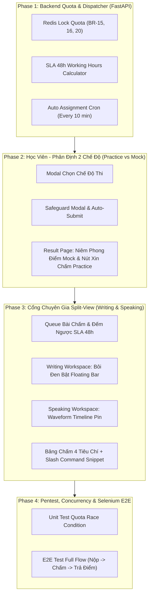

# KẾ HOẠCH TỔNG THỂ V2.0 (FINAL BATTLE-TESTED MASTER PLAN)
## PHÂN HỆ CHUYÊN GIA (EXPERT REVIEW) & 2 CHẾ ĐỘ THI (PRACTICE VS. MOCK TEST)

---

## 1. NGUYÊN TẮC THIẾT KẾ ĐÃ ĐƯỢC THỐNG NHẤT (DESIGN DECISIONS)

1. **Bảo tồn Tuyệt đối 33 Bảng Hiện Hữu (Zero New Tables):**
   - Loại bỏ hoàn toàn đề xuất tạo bảng thứ 34 `expert_comment_snippets`.
   - Toàn bộ nhận xét mẫu của Expert được lưu tại **`localStorage` trình duyệt** của giáo viên (tốc độ truy xuất $0\text{ms}$, hỗ trợ offline, có nút Export/Import JSON khi đổi máy).
2. **Duy Nhất 1 File Migration Tối Thiểu (Single Surgical Migration):**
   - Không thêm cột mới vào `attempts` (quản lý giữ chỗ bằng Redis key TTL).
   - Không thêm cột mới vào `criterion_scores` (lưu giải trình lệch điểm vào `review_assignments.note`).
   - Chỉ nới lỏng `annotations.essay_id DROP NOT NULL` và thêm `response_id, start_ms, end_ms` để tái sử dụng toàn bộ hệ thống đánh dấu lỗi cho Speaking.
   - Bổ sung giá trị `'declined'` cho enum `assignment_end` (FR-39).
3. **Cam kết 0% Lỗi Hồi Quy (Zero Regression Guarantee):**
   - Không ảnh hưởng đến Reading & Listening (sử dụng `answers`, `lr_sections`, `band_conversions`).
   - Không ảnh hưởng đến AI grading của Writing & Speaking (các ràng buộc đều backward-compatible).
   - Tận dụng 100% view `attempt_results` hiện có (`preliminary_band` vs `band`).

---

## 2. DDL MIGRATION CHI TIẾT (SINGLE FILE)

**Đường dẫn file:** `supabase/migrations/20261111000000_expert_workflow_core.sql`

```sql
-- ============================================================================
-- MIGRATION: EXPERT REVIEW WORKFLOW & SPEAKING ANNOTATIONS SUPPORT
-- Tuân thủ triệt để: Giữ nguyên 33 bảng, 0 bảng mới, 0 hồi quy.
-- ============================================================================

-- 1. Bổ sung giá trị 'declined' cho enum assignment_end (FR-39)
ALTER TYPE public.assignment_end ADD VALUE IF NOT EXISTS 'declined';

-- 2. Tinh chỉnh bảng annotations để hỗ trợ cả Speaking
ALTER TABLE public.annotations 
    ALTER COLUMN essay_id DROP NOT NULL,
    ALTER COLUMN start_pos DROP NOT NULL,
    ALTER COLUMN end_pos DROP NOT NULL,
    ALTER COLUMN original_text DROP NOT NULL;

-- 3. Bổ sung liên kết audio Speaking vào annotations
ALTER TABLE public.annotations 
    ADD COLUMN IF NOT EXISTS response_id uuid REFERENCES public.speaking_responses(id) ON DELETE CASCADE,
    ADD COLUMN IF NOT EXISTS start_ms integer,
    ADD COLUMN IF NOT EXISTS end_ms integer;

-- 4. Cập nhật CHECK category cho Speaking (FC - Fluency, P - Pronunciation)
ALTER TABLE public.annotations 
    DROP CONSTRAINT IF EXISTS annotations_category_check;
ALTER TABLE public.annotations 
    ADD CONSTRAINT annotations_category_check 
    CHECK (category IN ('TA', 'TR', 'CC', 'LR', 'GRA', 'FC', 'P'));

-- 5. Ràng buộc an toàn: Đúng 1 trong 2 mục tiêu (Writing Essay hoặc Speaking Response)
ALTER TABLE public.annotations 
    DROP CONSTRAINT IF EXISTS chk_annotation_target;
ALTER TABLE public.annotations 
    ADD CONSTRAINT chk_annotation_target 
    CHECK (
        (essay_id IS NOT NULL AND response_id IS NULL) OR 
        (essay_id IS NULL AND response_id IS NOT NULL)
    );

-- 6. Index tối ưu truy vấn lỗi Speaking theo response
CREATE INDEX IF NOT EXISTS idx_annotations_response 
    ON public.annotations (response_id, start_ms) 
    WHERE response_id IS NOT NULL;
```

---

## 3. LỘ TRÌNH 4 GIAI ĐOẠN TRIỂN KHAI (4-PHASE ROADMAP)



---

### GIAI ĐOẠN 1: BACKEND QUOTA, SLA & DISPATCHER (FASTAPI)
- **Files tạo mới / cập nhật:**
  - `backend/app/services/expert/quota_manager.py`: Kiểm tra và giữ chỗ Quota tuần (Thứ 2 00:00 GMT+7) bằng Redis Atomic Script:
    - BR-15: Tối đa 2 bài Mock/tuần cho mỗi Learner.
    - BR-16: Tối đa 3 bài Practice xin chấm lại/tuần.
    - BR-20: Suất chung cả trường `expert_weekly_capacity`.
  - `backend/app/services/expert/sla_service.py`: Tính hạn 48 giờ làm việc (08:00 - 18:00, Thứ 2 - Thứ 6 GMT+7).
  - `backend/app/services/expert/dispatcher.py`: Quét hàng đợi `review_requests(status='waiting')`, ghép với Expert `is_available=true` chưa vượt `max_active_reviews`, ưu tiên Mock trước Practice.
  - `backend/app/api/endpoints/expert.py`: Mở rộng đầy đủ CRUD endpoints.

---

### GIAI ĐOẠN 2: GIAO DIỆN HỌC VIÊN - LUỒNG PRACTICE VS MOCK TEST (`/ck:ui-ux-pro-max`)
- **1. TestPrepModal (`components/exam/TestPrepModal.tsx`):**
  - **Luyện tập (Practice)**: Không áp lực thời gian, tùy chọn Task, nhận điểm AI ngay lập tức.
  - **Thi thử (Mock Test)**: Đếm ngược, kiểm tra giữ chỗ trước khi bắt đầu. Huy hiệu: `🛡️ Suất chấm Chuyên gia: Đã bảo lưu (Còn 1/2 bài tuần này)`.
- **2. Phòng Thi Writing & Speaking:**
  - Đồng hồ đếm ngược cố định ở đỉnh màn hình.
  - **Auto-Submit on Timeout**: Khi về `00:00`, tự động thu bài và đóng phòng thi.
  - **Exam Safeguard Modal**: Bấm nộp sớm mà chưa viết đủ 2 Task $\rightarrow$ Cảnh báo bỏ trống sẽ nhận 0 điểm kèm công thức Cambridge $(T_1 + 2T_2)/3$.
- **3. Màn hình Kết Quả Thi (Result Summary):**
  - **Mock Test**: Điểm chính thức được **Niêm phong (Sealed)** kèm thời gian dự kiến trả bài. Vẫn mở phân tích lỗi ngữ pháp/từ vựng chi tiết để học viên ôn tập ngay.
  - **Practice**: Hiển thị điểm AI ngay, kèm nút `Gửi Chuyên gia chấm lại (Còn X/3 lượt)`.

---

### GIAI ĐOẠN 3: CỔNG CHUYÊN GIA SPLIT-VIEW PORTAL (`/ck:ui-ux-pro-max`)
- **Bố cục Split-View (Tỷ lệ 60/40 hoặc Resizable Splitter):**
  - **Cột Trái (60%): Bài làm học viên**
    - **Writing**: Văn bản bài viết. Bôi đen từ/câu $\rightarrow$ Toolbar nổi nhanh `[TR] [CC] [LR] [GRA] [Xóa]`.
    - **Speaking**: Audio Player từng câu hỏi + Thanh sóng âm (Waveform). Bấm `Space` tạm dừng $\rightarrow$ Click nút "Ghim lỗi âm thanh" tại đúng mốc giây.
  - **Cột Phải (40%): Bảng Chấm Điểm 4 Tiêu Chí**
    - Slider chọn Band từ $0.0 - 9.0$ (bước nhảy 0.5).
    - Tích hợp **Slash Command (`/`)** nạp nhận xét từ `localStorage` với độ trễ $0\text{ms}$.
    - Khay duyệt kho nhận xét mẫu (Snippet Drawer) phân loại theo tiêu chí.
    - Nếu sửa band lệch $\ge 1.0$ so với AI $\rightarrow$ Hiện bộ **Quick Chips lý do** (Off-topic, Collocations, Phonetics...) chọn trong 3 giây.
  - **Thanh Đáy (Sticky Footer):**
    - Tự động lưu nháp mỗi 10 giây (`draft evaluation`).
    - Nút `Từ chối nhận bài` (chỉ mở trong 2 giờ đầu làm việc, có đồng hồ đếm ngược).
    - Nút `Ký duyệt & Trả kết quả chính thức` (Thực hiện trong 1 Transaction an toàn).

---

### GIAI ĐOẠN 4: KIỂM THỬ TOÀN DIỆN & PENTEST BẢO MẬT
1. **Kiểm thử Concurrency:** Giả lập 10 requests cùng nộp bài khi hệ thống chỉ còn 1 suất cuối $\rightarrow$ Đảm bảo đúng 1 request được duyệt, 9 request còn lại chuyển sang điểm AI sạch sẽ.
2. **Kiểm thử SLA 48h:** Giao bài 15:00 Thứ Sáu $\rightarrow$ Kiểm tra deadline chính xác là 15:00 Thứ Ba tuần kế tiếp.
3. **Kiểm thử E2E Selenium:**
   - Học viên nộp bài Mock Writing $\rightarrow$ Bài vào hàng đợi.
   - Expert đăng nhập $\rightarrow$ Thấy bài mới qua Realtime $\rightarrow$ Chấm điểm và gán lỗi $\rightarrow$ Nộp bài.
   - Học viên kiểm tra lại kết quả $\rightarrow$ Điểm chính thức hiển thị, trạng thái chuyển `scored`.
