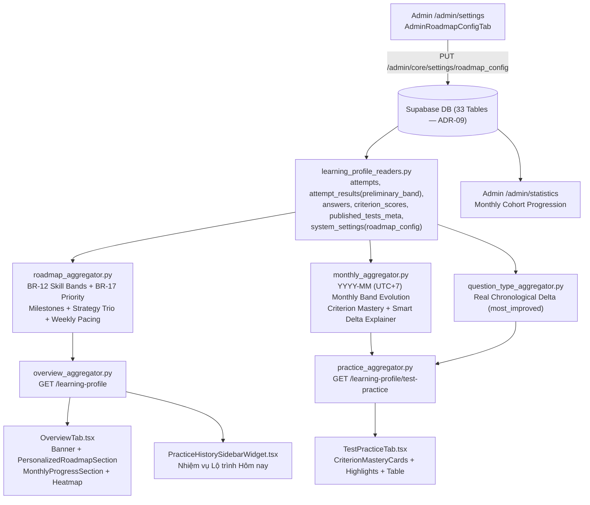

# Master Plan: Lộ trình Cá nhân hóa & Theo dõi Trình độ Hàng tháng (V2 — Red-Team Hardened)

**Tài liệu Nghiên cứu Nền tảng (`/ck:journal`):** [2026-11-17-personalized-roadmap-and-monthly-progress-research.md](file:///e:/Thuc%20tap%20tot%20nghiep/ielts-grader-project/docs/journals/2026-11-17-personalized-roadmap-and-monthly-progress-research.md)  
**Đặc tả Nghiệp vụ Gốc:** [source-of-truth.md](file:///e:/Thuc%20tap%20tot%20nghiep/ielts-grader-project/docs/source-of-truth.md) (`BR-02`, `BR-03`, `BR-08`, `BR-12`, `BR-15`, `BR-16`, `BR-17`, `FR-06`, `FR-07`, `FR-08`, `NFR-06`, `ADR-09`)

---

## 1. Mục tiêu Tổng quát

1. **Cá nhân hóa lộ trình luyện đề (`FR-08`, `BR-12`, `BR-17`)**:
   - Chẩn đoán trình độ thực tế từng kỹ năng (ưu tiên **3 Mock chính thức gần nhất** > **5 Practice gần nhất** > **Diagnostic Test** nếu `< 2` bài).
   - Chia chặng mục tiêu (`Band Stepping Stones` 0.5–1.0 band), tính **Nhịp độ tuần tự cân bằng (Self-Healing Weekly Pacing)** theo `test_date`, chỉ rõ dạng câu hỏi/tiêu chí yếu nhất bằng số liệu thật, kèm **Chiến lược làm bài 3 bước** và **Bộ 3 Bài luyện Chiến lược (Smart Practice Trio: Micro-Drill → Difficulty-Matched Practice → Mock + Expert Review)**.
2. **Theo dõi trình độ thay đổi hàng tháng (Monthly Band Evolution)**:
   - Tổng hợp lịch sử luyện thi theo múi giờ Việt Nam (`YYYY-MM`, `UTC+7`) với **Scorecard Đối chiếu Tháng này vs. Tháng trước**, **Biểu đồ Đa trục Tiến hóa Band Hàng tháng** (kèm lọc `Overall | L | R | W | S`), **Chỉ số Quá trình (`accuracy_pct`, `study_hours`)**, cờ **`is_provisional`** khi đầu tháng chưa đủ 2 bài, và **Smart Delta Explainer** chống tâm lý hoang mang khi chuyển từ Practice sang Mock.
3. **Đồng bộ Toàn diện Học viên & Quản trị viên**:
   - Học viên quản lý đủ 4 band mục tiêu kỹ năng tại `GoalSetterModal`, xem bảng 8 tiêu chí W/S (`CriterionMasteryCards`), và thấy thẻ nhiệm vụ ưu tiên ngay tại sidebar `/test-practice`.
   - Admin tùy chỉnh trực tiếp tham số lộ trình (`roadmap_config` trong `system_settings`) tại `/admin/settings` và theo dõi tiến độ tăng band học viên toàn hệ thống theo tháng tại `/admin/statistics`.

---

## 2. Kiến trúc Luồng Dữ liệu End-to-End

---

## 3. Danh sách 6 Lỗ hổng Red Team Đã Khóa trong Plan

1. **Chống ảo giác Band 8.0–9.0 từ 1 bài ngắn 5 câu**: Bù `input_band` cho kỹ năng `< 2 bài` khi tính `predicted_band` (`BR-02`), phân loại rõ độ tin cậy `high | low | insufficient` (`BR-12`).
2. **Sửa thẻ `"Cải thiện tốt"` (`most_improved`)**: Tính chênh lệch thực tế giữa nửa sau và nửa đầu lịch sử câu trả lời của từng dạng bài thay vì lấy nhầm phần tử cao thứ 2.
3. **Bổ sung Metadata Đề thi**: Lấy thêm `difficulty`, `source_name` (`micro_exercise` vs Full Test), `question_type`/`subtype`, và `task_type` để gợi ý đúng đề chữa điểm nghẽn.
4. **Minh bạch bài đang `waiting_expert` (`NFR-06`)**: Đọc thêm `preliminary_band` để thông báo cho học viên thay vì làm bài thi vừa nộp biến mất khỏi bảng thống kê.
5. **Chống bẫy cảm xúc đầu tháng mới**: Gắn `is_provisional = True` nếu tháng có `< 2 bài` và giải thích nguyên nhân biến động theo tỷ lệ đề `Mock`/`Hard`.
6. **Đồng bộ Cache & Điểm chạm**: Xóa cache learning profile ở `PUT /api/v1/users/me/goals`, loại bỏ mọi điểm giả hardcoded ở `PracticeHistoryRadarCard.tsx` / `PracticeQuestionTypeAccuracyCard.tsx`, và gắn thẻ nhiệm vụ lộ trình ở sidebar `/test-practice`.

---

## 4. Quy tắc Ràng buộc Triển khai

- **Kiến trúc Database**: Không tạo bảng mới; sử dụng `public.system_settings` (`key = 'roadmap_config'`).
- **Modularization (`AGENTS.md`)**: Tất cả file code mới và chỉnh sửa giữ dưới **200 dòng code (`< 200 LOC`)**; tách helper/service rõ ràng.
- **UI/UX Pro Max & Strict Purple Ban**: Không sử dụng màu `purple`, `violet`, `indigo`. Dùng chuẩn màu **PTIT Crimson `#932120`**, **Prep Blue `#2563eb`**, **Emerald `#10b981`**, **Amber `#f59e0b`**, **Zinc `#18181b`**.
- **An toàn & Chính xác**: Mọi đề gợi ý chỉ lấy đề `status = 'published'` và tuyệt đối không gửi đáp án về client trước khi làm bài.

---

## 5. Các Phase Triển khai Chi tiết

| Phase | Tài liệu Chi tiết | Phạm vi chính | Trạng thái |
| :--- | :--- | :--- | :--- |
| **Phase 1** | [phase-01-backend-br12-and-roadmap-engine.md](file:///e:/Thuc%20tap%20tot%20nghiep/ielts-grader-project/plans/261117-1640-personalized-roadmap-and-monthly-progress/phase-01-backend-br12-and-roadmap-engine.md) | Readers mở rộng, `BR-12` skill band, `BR-17` `roadmap_aggregator.py`, sửa `question_type_aggregator.py`, xóa cache ở `users.py` | `pending` |
| **Phase 2** | [phase-02-backend-monthly-and-admin-config.md](file:///e:/Thuc%20tap%20tot%20nghiep/ielts-grader-project/plans/261117-1640-personalized-roadmap-and-monthly-progress/phase-02-backend-monthly-and-admin-config.md) | `monthly_aggregator.py` (chuẩn UTC+7), `criterion_mastery` 8 tiêu chí W/S, chẩn đoán AI thật trong `practice_aggregator.py`, Admin `roadmap_config` upsert + Monthly Cohort Stats | `pending` |
| **Phase 3** | [phase-03-frontend-learner-roadmap-and-monthly-ux.md](file:///e:/Thuc%20tap%20tot%20nghiep/ielts-grader-project/plans/261117-1640-personalized-roadmap-and-monthly-progress/phase-03-frontend-learner-roadmap-and-monthly-ux.md) | `PersonalizedRoadmapSection`, `MonthlyProgressSection`, `CriterionMasteryCards`, nâng cấp `GoalSetterModal` & `LearningProfileBanner`, sửa Sidebar & xóa mock fallback | `pending` |
| **Phase 4** | [phase-04-frontend-admin-and-e2e-verification.md](file:///e:/Thuc%20tap%20tot%20nghiep/ielts-grader-project/plans/261117-1640-personalized-roadmap-and-monthly-progress/phase-04-frontend-admin-and-e2e-verification.md) | `AdminRoadmapConfigTab` ở `/admin/settings`, Monthly Cohort Chart ở `/admin/statistics`, TypeCheck `tsc`, Purple Ban, `< 200 LOC` audit, Backend & E2E verification | `pending` |
